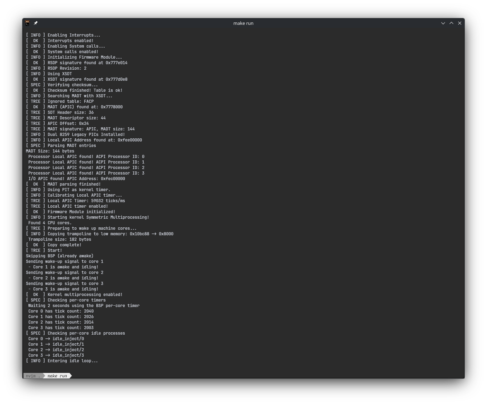

# My Own Kernel (Zig Edition)


> **Project archived:** I'm taking a break from this project to focus on studying other topics for my career. Thanks for stopping by and taking an interest in it!

My Own Kernel is a personal learning project: an x86_64 operating system kernel written in Zig. It began as a way to explore how computers start up and how an operating system communicates with the hardware beneath it.

The project started in C and later moved to Zig. In simple terms, a small UEFI program starts the machine and loads the kernel. The kernel then sets up the basic environment it needs to run, including memory and processor support. QEMU can emulate a computer so the project can be built and tried without dedicated hardware.

---

## Screenshots

> *Current state of the kernel running in QEMU, booting via UEFI with the serial output, printed in stdio*



---

## How to Build and Run

### Dependencies

| Tool | Purpose |
|------|---------|
| **Zig 0.15** | Primary compiler (managed via [zvm](https://github.com/tristanisham/zvm)) |
| **QEMU** | Emulator for testing |
| **OVMF** | UEFI firmware (`/usr/share/edk2/x64/OVMF.4m.fd`) |

> **Important:** The project uses Zig **0.15**. Install it with `zvm install 0.15 && zvm use 0.15`.

### Makefile Targets

```bash
# Build and boot via UEFI (recommended)
make run

# Debug mode (QEMU + GDB stub)
make debug

# Clean build artifacts
make clean

# List discovered Zig sources
make info
```

---

## Project Structure

```text
/
├── kernel/
│   ├── arch/x86/        # Architecture-specific code (GDT, IDT, paging, syscall ABI, boot)
│   │   ├── firmware/    # Firmware core (ACPI)
│   │   ├── interrupts/  # PIC, APIC and IDT stubs
│   │   ├── mem/         # Paging, memory layout
│   │   ├── cpu/         # CPU features (GDT, TSS, syscalls)
│   │   └── sys/         # Syscall entry/context
│   ├── boot/            # UEFI bootloader (start.zig) + BootInfo shared struct
│   ├── hal/             # Interface definitions (e.g., TimerSource)
│   ├── mm/              # Memory management (PMM, VMM, heap)
│   ├── proc/            # Process manager
│   ├── sch/             # Scheduler + context switch
│   ├── sys/             # Syscall handlers
│   ├── utils/           # Logger│   
    └── lib/             # Generic library code (I/O, logging helpers)
├── build.zig            # Zig build system (cross-compilation, UEFI target)
├── linker.ld            # Linker script (UEFI boot path)
└── Makefile             # Build automation
```

## License

This project is licensed under the MIT License.
